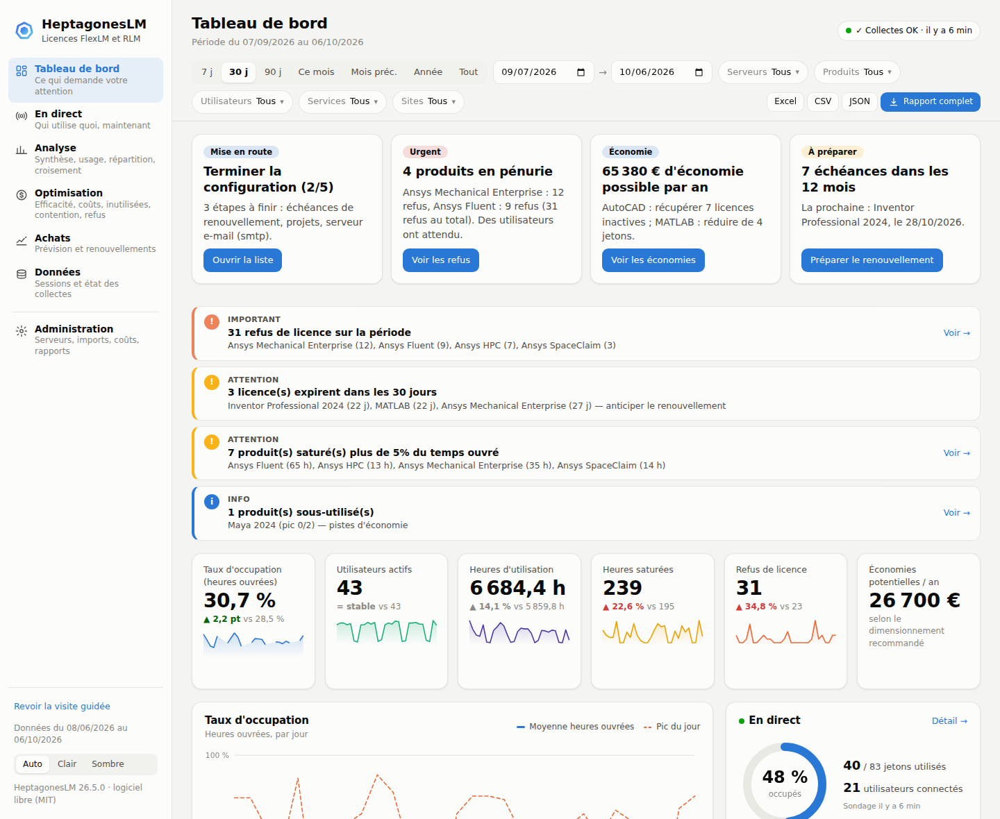
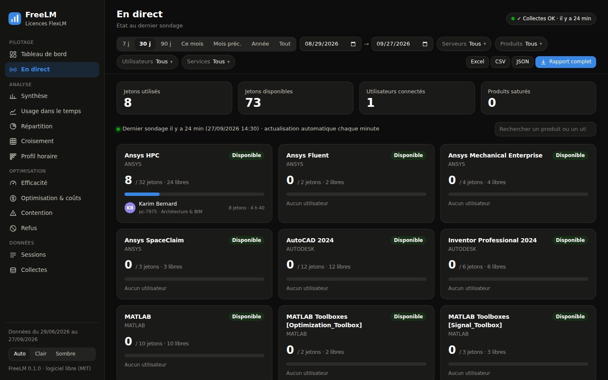
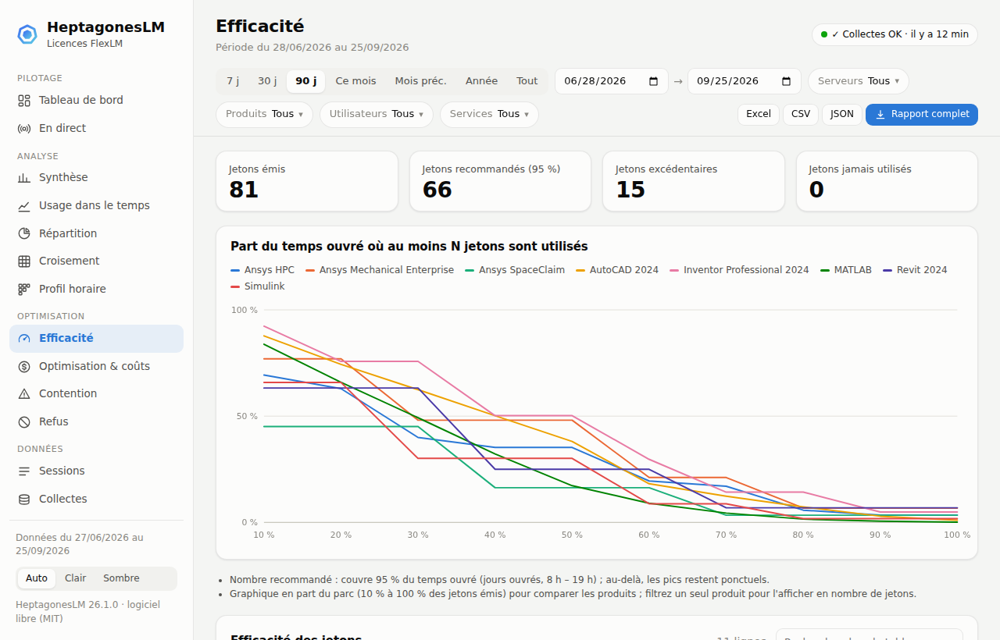
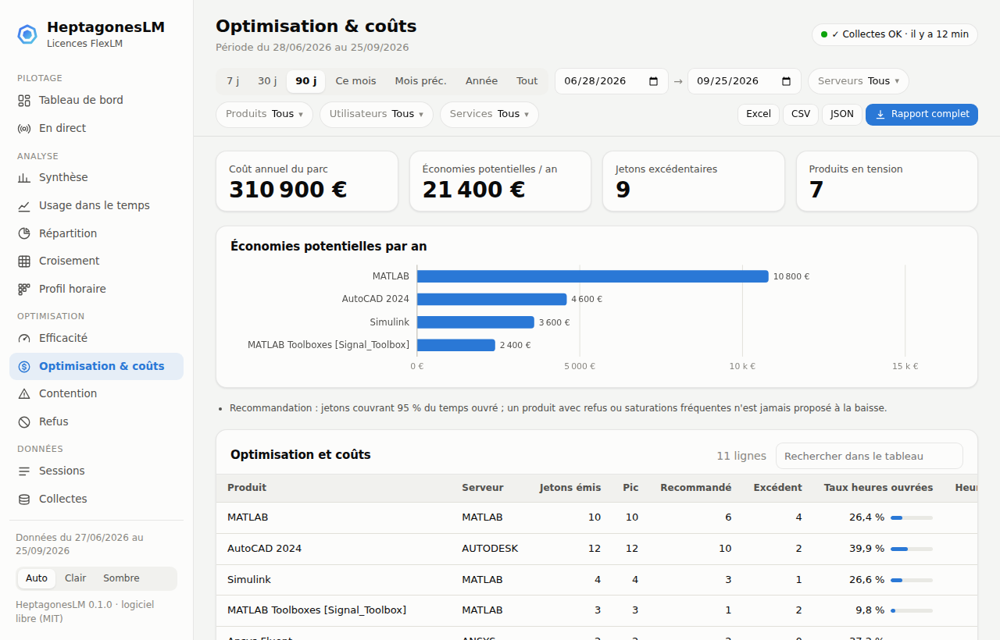
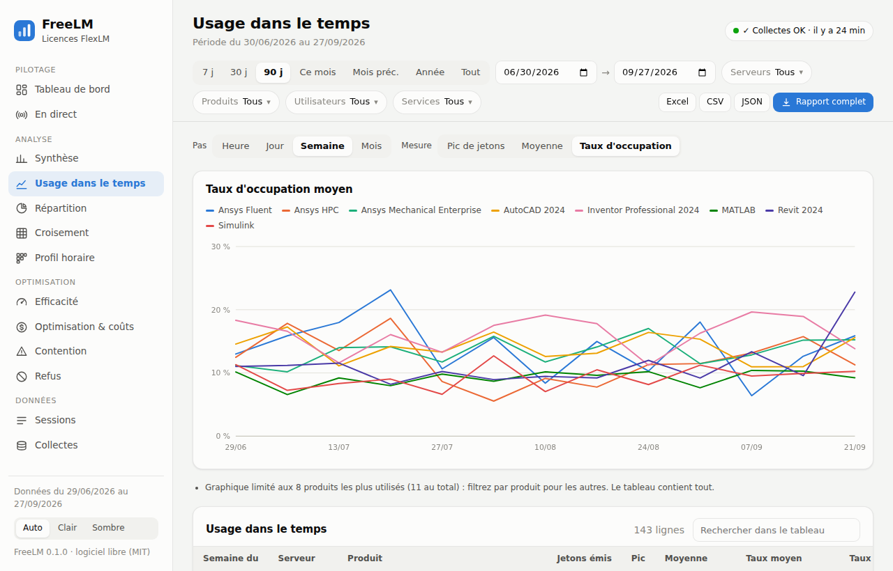
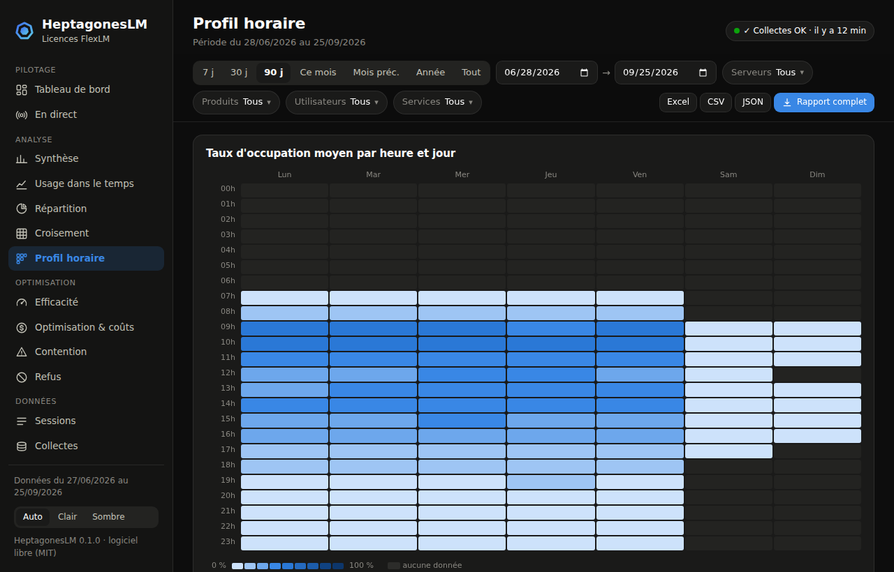

# HeptagonesLM


[](https://github.com/Valou94460/HEPTAGONES-LM/actions/workflows/ci.yml)


[](LICENSE)

**Suivi et reporting open source de la consommation de licences FlexLM / FlexNet et RLM**
(Autodesk, Ansys, MATLAB… et tout éditeur utilisant FlexNet Publisher ; Foundry, Maxon,
Chaos… avec Reprise License Manager).
Une alternative gratuite à OpenLM pour la mesure et l'optimisation des licences.

HeptagonesLM interroge périodiquement vos serveurs de licences (`lmutil lmstat`,
`rlmutil rlmstat`) et lit leurs logs, historise la consommation dans SQL Server, puis restitue **qui utilise
quoi, quand, avec quel taux d'occupation et quels pics de contention**, dans une
tableau de bord web et en exports Excel — avec alertes, vue en direct, efficacité des
jetons, chiffrage des économies possibles et alertes immédiates par e-mail.



## Sommaire

- [Fonctionnalités](#fonctionnalités)
- [Démarrage rapide](#démarrage-rapide)
- [Installation en production](#installation-en-production)
- [Utilisation](#utilisation)
- [Interface web](#interface-web)
- [Configuration](#configuration)
- [Rapport mensuel par e-mail](#rapport-mensuel-par-e-mail)
- [Comparaison avec OpenLM](#comparaison-avec-openlm)
- [Documentation](#documentation)
- [Développement et tests](#développement-et-tests)

## Fonctionnalités

| | |
|---|---|
| **Collecte** | FlexLM : sondage `lmutil lmstat -a` (jetons émis/utilisés, checkouts en cours) et lecture incrémentale des logs debug (refus, sessions à la seconde). RLM : sondage `rlmutil rlmstat -a` (pools, jetons, utilisateurs, échéances). Aucun agent sur les postes clients. |
| **Historisation** | SQL Server (ou SQLite pour les essais) : sessions, refus, sondages, agrégats horaires conservés sans limite, journal des collectes. |
| **Tableau de bord** | Alertes (collecte en échec ou arrêtée, refus, licences qui expirent, saturation, sous-utilisation), 6 indicateurs clés comparés à la période précédente avec tendance, occupation, état en direct, top produits et utilisateurs, refus, profil horaire, serveurs et échéances. |
| **En direct** | Jetons utilisés / disponibles par produit et qui les utilise, depuis quand, sur quel poste ; actualisé chaque minute. |
| **Optimisation** | Efficacité des jetons (part du temps où au moins N jetons sont utilisés), nombre de jetons recommandé, coût annuel du parc, économies potentielles, refacturation par service. |
| **Rapports** | 13 vues à la demande, filtres (période, serveurs, produits, utilisateurs, services), graphiques interactifs, mode clair / sombre, liens partageables. |
| **Exports** | Chaque rapport en Excel (avec graphique), CSV (format Excel français) ou JSON ; classeur complet 8 onglets. |
| **HeptagonesLM.exe** | Exécutable Windows autonome : double-clic → interface dans le navigateur. Aucun Python requis. |
| **HeptagonesLM-Setup.exe** | Assistant d'installation graphique : prérequis et IIS installés automatiquement, tests de connexion, barre de progression, vérification finale ; mode silencieux. |
| **Connexion Windows / AD** | Page de connexion avec les identifiants Windows (LDAPS), restriction par groupe AD, ou authentification unique derrière IIS. HTTPS intégré, journal d'audit des connexions et des exports. |
| **Alertes par e-mail** | Dès la collecte suivante : collecte en échec ou arrêtée (puis « rétablie »), nouveaux refus, plus aucun jeton disponible, licence qui expire (J-30, J-7, expirée). Sans répétition inutile, rappel au plus une fois par jour. |
| **Rapport par e-mail** | Abonnements (destinataires, période, serveurs, produits) : résumé HTML + classeur Excel joint, envoyé une fois par mois. |
| **Automatisation** | Tâches planifiées Windows (collecte toutes les 5 min, rapport mensuel, envoi des e-mails, purge, interface permanente). |
| **Référentiel** | Correspondance feature technique → produit lisible (`87545ACD_2024_0F` → AutoCAD 2024), services et noms importés de l'AD. |
| **Extensible** | Architecture à collecteurs : d'autres gestionnaires (DSLS, LM-X…) s'ajoutent sans toucher au reste, comme RLM. |

<table>
<tr>
<td></td>
<td></td>
</tr>
<tr>
<td align="center"><em>En direct : qui utilise quoi, maintenant</em></td>
<td align="center"><em>Efficacité : combien de jetons sont vraiment nécessaires</em></td>
</tr>
<tr>
<td></td>
<td></td>
</tr>
<tr>
<td align="center"><em>Optimisation : coûts et économies potentielles</em></td>
<td align="center"><em>Taux d'occupation dans le temps</em></td>
</tr>
</table>

## Démarrage rapide

### Essayer en 1 minute (Windows, sans rien installer)

1. Télécharger **`HeptagonesLM.exe`** depuis la page [Releases](https://github.com/Valou94460/HEPTAGONES-LM/releases)
   (ou, pour la dernière version de développement : onglet
   [Actions](https://github.com/Valou94460/HEPTAGONES-LM/actions/workflows/ci.yml) › dernière exécution › artefact `HeptagonesLM-windows`).
2. Double-cliquer : l'interface s'ouvre dans le navigateur sur des **données de
   démonstration** (3 serveurs simulés, ~45 utilisateurs, 90 jours).

> Windows SmartScreen peut avertir au premier lancement (exécutable non signé) :
> « Informations complémentaires » › « Exécuter quand même ».

### Avec Python

```bash
pip install git+https://github.com/Valou94460/HEPTAGONES-LM.git
heptagoneslm web --demo --open          # interface sur données simulées
heptagoneslm demo --days 30             # ou : base + rapport Excel de démonstration dans ./demo
```

## Installation en production

### Installation assistée (recommandée)

Double-cliquer sur **`HeptagonesLM-Setup.exe`** (page [Releases](https://github.com/Valou94460/HEPTAGONES-LM/releases)) :
un assistant s'ouvre dans le navigateur et installe tout, en contrôlant chaque étape.

1. **Vérification du serveur** : Windows, droits, pilote ODBC, lmutil, rôles et modules IIS —
   ce qui manque (IIS, URL Rewrite, ARR) s'installe en un clic.
2. **Configuration guidée** avec un bouton « Tester » à chaque étape : compte de service,
   SQL Server (création de la base et des droits), serveurs de licences (lmstat en direct),
   IIS avec connexion Windows automatique et groupe AD, e-mail.
3. **Installation avec barre de progression** et journal en direct, reprise sur échec.
4. **Vérification de bout en bout** : base, collecte de chaque serveur, tâches planifiées,
   interface, site IIS et authentification Windows, pare-feu, DNS ; rapport d'installation.


Installation silencieuse (industrialisation) : `HeptagonesLM-Setup.exe setup --answers reponses.json`.
Démonstration sans rien modifier : `HeptagonesLM.exe setup --simulate`.
Tout est détaillé dans **[docs/INSTALLATION.md](docs/INSTALLATION.md)**.

### Installation manuelle

Prérequis sur le serveur HeptagonesLM (Windows) :

- accès réseau aux serveurs de licences (port `lmgrd` et ports des démons vendeurs) ;
- `lmutil.exe` (fourni avec tout gestionnaire FlexLM, ex. Autodesk Network License Manager) ;
- [ODBC Driver 18 for SQL Server](https://learn.microsoft.com/sql/connect/odbc/download-odbc-driver-for-sql-server) ;
- soit `HeptagonesLM.exe`, soit Python 3.10+ (64 bits).

**1. Base de données** (une fois, par un DBA) :

```powershell
sqlcmd -S SQLSRV01 -i sql\sqlserver\00_create_database.sql   # base + compte de service
```

**2. Configuration** : copier [`config/heptagoneslm.example.yaml`](config/heptagoneslm.example.yaml)
en `C:\HeptagonesLM\heptagoneslm.yaml` et renseigner la base, `lmutil` et les serveurs.

**3. Initialisation et vérification** :

```powershell
cd C:\HeptagonesLM
.\HeptagonesLM.exe -c heptagoneslm.yaml init-db                    # crée les tables (ou sql\sqlserver\01_schema.sql)
.\HeptagonesLM.exe -c heptagoneslm.yaml test-server --server AUTODESK
.\HeptagonesLM.exe -c heptagoneslm.yaml collect
```

(avec Python : `py -3 -m venv venv`, `venv\Scripts\pip install .`, puis `venv\Scripts\heptagoneslm` à la place de `HeptagonesLM.exe`)

**4. Planification** :

```powershell
powershell -ExecutionPolicy Bypass -File scripts\register_tasks.ps1 -HeptagonesLMHome C:\HeptagonesLM -ServiceAccount "DOMAINE\gmsa_heptagoneslm$"
```

Le compte de service est obligatoire (compte dédié non administrateur, gMSA
recommandé ; SYSTEM est refusé). Crée les tâches : collecte toutes les 5 minutes, rapport Excel du mois précédent
(généré une fois par mois, même si le 1er est manqué), envoi des rapports par e-mail,
purge hebdomadaire ; `-WithWebInterface` ajoute l'interface web permanente.

**5. Référentiel** (recommandé) :

```powershell
# Services et noms complets depuis l'AD
Get-ADUser -Filter * -Properties DisplayName,Department |
  Select-Object SamAccountName,DisplayName,Department |
  Export-Csv users.csv -NoTypeInformation -Encoding UTF8
.\HeptagonesLM.exe -c heptagoneslm.yaml import-users users.csv

# Reprise de l'historique depuis des logs archivés
.\HeptagonesLM.exe -c heptagoneslm.yaml import-log --server ANSYS D:\archives\license_2026-08.log
```

## Utilisation

| Commande | Rôle |
|---|---|
| `heptagoneslm init-db` | Crée / complète le schéma, référence les serveurs du YAML |
| `heptagoneslm collect [--server X]` | Une collecte (à planifier). Code retour 2 si un serveur est en échec |
| `heptagoneslm web [--open] [--port 8765] [--host …] [--demo]` | Interface web |
| `heptagoneslm report [--period last-month\|this-month\|last-week\|last-7d\|last-year]` | Rapport Excel complet |
| `heptagoneslm report --from 2026-09-01 --to 2026-10-01 --server ANSYS -o rapport.xlsx` | Période et serveurs au choix (fin exclue) |
| `heptagoneslm import-log --server X fichier.log…` | Reprise d'historique depuis des logs archivés |
| `heptagoneslm import-users users.csv` | Noms complets et services (export AD/RH) |
| `heptagoneslm send-report [--skip-sent] [--dry-run DOSSIER] [--to adresse]` | Envoi du rapport aux abonnés e-mail (aperçu `.eml` avec `--dry-run`) |
| `heptagoneslm apply-products` | Réapplique le mapping feature → produit à tout l'historique |
| `heptagoneslm purge` | Applique la politique de rétention |
| `heptagoneslm test-server --server X` | Interroge un serveur sans rien écrire |
| `heptagoneslm parse-lmstat fichier.txt` / `parse-log fichier.log` | Diagnostic des parsers (sans base) |
| `heptagoneslm demo [--days N] [--connection-string …]` | Environnement de démonstration simulé |
| `heptagoneslm ddl --dialect mssql` | Script SQL du schéma |

Options globales : `-c heptagoneslm.yaml` (ou variable `HEPTAGONESLM_CONFIG`), `-v` (logs détaillés).
`HeptagonesLM.exe` accepte exactement les mêmes commandes.

## Interface web

```bash
heptagoneslm -c heptagoneslm.yaml web --open
```

Navigation par la barre latérale, en quatre groupes :

| Vue | Contenu |
|---|---|
| **Tableau de bord** | Page d'accueil : alertes, indicateurs clés cliquables (tendance, comparaison à la période précédente), taux d'occupation, état en direct, produits, utilisateurs, refus, profil horaire, serveurs et échéances |
| **En direct** | Dernier sondage : jetons utilisés / libres par produit, utilisateurs connectés (poste, service, durée), file d'attente ; actualisation automatique |
| Synthèse | Indicateurs clés, taux d'occupation par produit (moyen, au pic, heures ouvrées) |
| Usage dans le temps | Pic / moyenne / taux par heure, jour, semaine ou mois |
| Répartition | Heures par utilisateur, poste, service, produit, serveur ou éditeur |
| Croisement | Tableau croisé (utilisateur, poste ou service) × produit |
| Profil horaire | Carte de chaleur heure × jour de semaine |
| Contention | Jours avec saturation des jetons et/ou refus |
| Refus | Détail des refus (DENIED) issus des logs |
| **Efficacité** | Part du temps ouvré où au moins N jetons sont utilisés ; jetons recommandés pour couvrir 95 % du temps, excédent, jetons jamais utilisés |
| **Optimisation & coûts** | Coût annuel par produit, économies potentielles, coût par heure d'usage, recommandation (réduire, adapté, pénurie) |
| Sessions | Données brutes filtrables |
| Collectes | Journal et état de santé des collectes |

- **Filtres** : période (7 j, 30 j, 90 j, mois, année… ou dates), serveurs, produits,
  utilisateurs, services ; ils s'appliquent à toutes les vues.
  L'adresse de la page conserve les filtres : un lien partagé rouvre le même rapport.
- **Exports** : bouton Excel / CSV / JSON sur chaque vue, avec les filtres appliqués ;
  « Rapport complet » produit le classeur 8 onglets.
- **Sécurité** : lecture seule ; n'écoute que sur le poste local par défaut.
  Pour un accès réseau : **connexion avec les comptes Windows / AD** et HTTPS, voir
  [docs/AUTHENTIFICATION.md](docs/AUTHENTIFICATION.md).

### Connexion Windows / Active Directory

```yaml
web:
  host: 0.0.0.0
  tls_cert: "C:/HeptagonesLM/certs/heptagoneslm.pem"
  tls_key:  "C:/HeptagonesLM/certs/heptagoneslm.key"
  auth:
    mode: ldap                                  # ou header : SSO derrière IIS
    ldap_servers: ["ldaps://dc01.entreprise.local"]
    base_dn: "DC=entreprise,DC=local"
    upn_suffix: "entreprise.local"
    allowed_groups: ["GG_HeptagonesLM_Lecteurs"]
```

Identifiants vérifiés par l'AD (jamais stockés), groupes imbriqués, blocage après
échecs répétés, session de 8 h, journal d'audit (connexions et exports). HeptagonesLM refuse
d'exposer la page de connexion sur le réseau sans HTTPS.

## Rapport mensuel par e-mail

```yaml
email:
  smtp_host: smtp.entreprise.local
  sender: "HeptagonesLM <heptagoneslm@entreprise.local>"
  subscriptions:
    - name: Direction
      recipients: [dsi@entreprise.local, achats@entreprise.local]
    - name: Simulation
      recipients: [responsable.simulation@entreprise.local]
      servers: [ANSYS]
```

Chaque abonné reçoit un résumé (indicateurs clés, produits en pénurie — avec refus ou
saturés plus de 5 % des heures ouvrées —, produits sous-utilisés, détail par produit,
lien vers l'interface) et le classeur Excel complet en pièce jointe.

```powershell
HeptagonesLM.exe -c heptagoneslm.yaml send-report --dry-run apercu      # .eml à ouvrir dans Outlook, rien n'est envoyé
HeptagonesLM.exe -c heptagoneslm.yaml send-report --to moi@entreprise.local   # envoi de test
```

La tâche planifiée « Envoi des rapports » (`send-report --skip-sent`, quotidienne)
n'envoie chaque abonnement qu'une fois par période et rattrape un 1er du mois manqué ;
les envois sont tracés en base (`report_delivery`).

### Alertes immédiates

```yaml
email:
  alerts:
    recipients: [exploitation@entreprise.local]
    # types: [collection, denial, saturation, expiry]   # défaut : toutes
    # repeat_hours: 24                                  # rappel d'une alerte toujours présente
```

Évaluées après chaque collecte (toutes les 5 minutes), elles partent en un seul message :

| Type | Déclencheur |
|---|---|
| `collection` | Collecte en échec sur un serveur (puis message « rétablie »), aucune collecte depuis plus d'une heure |
| `denial` | Nouveaux refus de licence sur un produit (utilisateurs concernés) |
| `saturation` | Plus aucun jeton disponible sur une licence au dernier sondage |
| `expiry` | Licence qui expire dans `expiry_days` jours (30 par défaut), dans 7 jours, ou expirée |

Une alerte toujours présente n'est rappelée qu'après `repeat_hours` ; un SMTP indisponible ne
fait perdre aucune alerte (renvoyée à la collecte suivante). Aperçu sans envoi :
`HeptagonesLM.exe -c heptagoneslm.yaml check-alerts --dry-run apercu`.



## Configuration

Exemple complet et commenté : [`config/heptagoneslm.example.yaml`](config/heptagoneslm.example.yaml).

```yaml
database:
  connection_string: "DRIVER={ODBC Driver 18 for SQL Server};SERVER=sqlsrv01.entreprise.local;DATABASE=HeptagonesLM;Trusted_Connection=yes;Encrypt=yes"
lmutil_path: "C:/HeptagonesLM/bin/lmutil.exe"

servers:
  - name: AUTODESK
    port_at_host: "27000@licsrv1"
    collectors: [lmstat]                 # sondage lmstat seul
    sessions_from: lmstat
  - name: ANSYS
    port_at_host: "1055@licsrv2"
    collectors: [lmstat, log]            # + log : refus et sessions à la seconde
    sessions_from: log
    log_path: "\\\\licsrv2\\ansys_logs$\\license.log"

products:                                # feature FlexLM -> produit lisible
  - { pattern: "87545ACD_2024_*", product: "AutoCAD 2024", publisher: Autodesk, annual_cost: 2300 }
  - { pattern: "MATLAB", product: "MATLAB", publisher: MathWorks, annual_cost: 2700 }

reporting:
  currency: "€"                          # devise des coûts
  target_coverage: 0.95                  # jetons recommandés : couvrir 95 % du temps ouvré
```

`annual_cost` (coût annuel d'un jeton, optionnel) active le chiffrage : coût du parc,
économies potentielles et refacturation par service. Les dates d'expiration sont lues
automatiquement dans la sortie `lmstat` (alertes à 30 et 7 jours).

**lmstat ou log ?** `lmstat` suffit pour les taux d'occupation et les sessions
(précision : l'intervalle de sondage). Le **log** ajoute les refus et des sessions
à la seconde : à activer dès que le fichier est accessible (partage réseau).

## Comparaison avec OpenLM

| | HeptagonesLM | OpenLM |
|---|:---:|:---:|
| Coût de licence | Gratuit (MIT) | Payant |
| Collecte FlexLM (lmstat + logs), sans agent client | ✅ | ✅ |
| Collecte RLM (Reprise) | ✅ | ✅ |
| Historique SQL Server | ✅ | ✅ |
| Rapports d'usage, contention, refus, par service | ✅ | ✅ |
| Tableau de bord avec alertes (serveur, refus, expiration, saturation) | ✅ | ✅ |
| Vue en direct (jetons et utilisateurs connectés) | ✅ | ✅ |
| Efficacité des jetons, recommandation de dimensionnement | ✅ | ✅ |
| Coûts, économies potentielles, refacturation par service | ✅ | ✅ |
| Interface web + exports Excel / CSV | ✅ | ✅ |
| Connexion comptes Windows / AD, restriction par groupe | ✅ | ✅ |
| Rapports périodiques par e-mail | ✅ | ✅ |
| Alertes immédiates par e-mail (collecte, refus, saturation, échéances) | ✅ | ✅ |
| Rôles fins (droits par service, administration en ligne) | ❌ | ✅ |
| Libération de licences inactives (agent sur les postes), tickets | ❌ | ✅ |
| Licences SaaS / cloud, connecteur ServiceNow, offre hébergée | ❌ | ✅ |
| Autres gestionnaires (DSLS, Sentinel, LM-X… : plus de 70 chez OpenLM) | Extensible, à développer | ✅ |

Les écarts restants sont planifiés dans la [feuille de route](docs/ROADMAP.md).

## Documentation

| Document | Contenu |
|---|---|
| [docs/INSTALLATION.md](docs/INSTALLATION.md) | **Installation assistée** (HeptagonesLM-Setup.exe), installation silencieuse, serveur hors ligne, dépannage |
| [docs/DEX_HeptagonesLM.docx](docs/DEX_HeptagonesLM.docx) | **Dossier d'exploitation (Word)** : architecture, installation, exploitation, supervision, guide de l'interface illustré, sauvegarde, sécurité, incidents, maintenance, PRA |
| [docs/ARCHITECTURE.md](docs/ARCHITECTURE.md) | Architecture, flux de collecte, schéma de base, ajout d'un gestionnaire (RLM…) |
| [docs/AUTHENTIFICATION.md](docs/AUTHENTIFICATION.md) | Interface partagée : connexion AD (LDAPS), SSO via IIS, certificat HTTPS, service permanent |
| [docs/SECURITE.md](docs/SECURITE.md) | Audit de sécurité, corrections, liste de contrôle de déploiement |
| [docs/PLAN_DE_TEST.md](docs/PLAN_DE_TEST.md) | Plan de test complet : automatisé, recette, validation sur serveurs réels |
| [docs/ROADMAP.md](docs/ROADMAP.md) | **Feuille de route** : état réel face à OpenLM, lots 26.3 à 27.2 (ITSM, rôles, prévision, gestionnaires, agent poste, cloud) |
| [docs/PLAN.md](docs/PLAN.md) | Plan d'implémentation (mise en service) |
| [CHANGELOG.md](CHANGELOG.md) | Historique des versions |
| [CONTRIBUTING.md](CONTRIBUTING.md) | Contribuer : environnement, tests, conventions |

## Développement et tests

```bash
git clone https://github.com/Valou94460/HEPTAGONES-LM.git && cd HEPTAGONES-LM
pip install -e ".[dev]"
python -m pytest                     # ~90 tests, SQLite en mémoire, aucun serveur requis
heptagoneslm web --demo --open             # interface sur données simulées
```

La [CI](.github/workflows/ci.yml) exécute à chaque push : tests unitaires (Linux et
Windows, Python 3.10 et 3.12), démonstration complète avec rapport Excel, test de
l'interface et de la page de connexion dans un vrai navigateur (Playwright), démonstration contre un vrai
SQL Server 2022, construction et vérification de `HeptagonesLM.exe`. Une étiquette
`vX.Y.Z` publie automatiquement une [Release](https://github.com/Valou94460/HEPTAGONES-LM/releases)
avec l'exécutable.

## Licence

[MIT](LICENSE) — libre d'utilisation, de modification et de redistribution.
