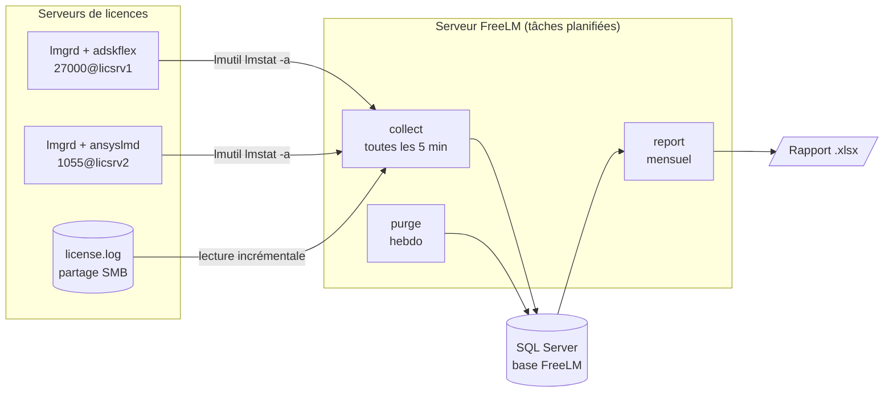
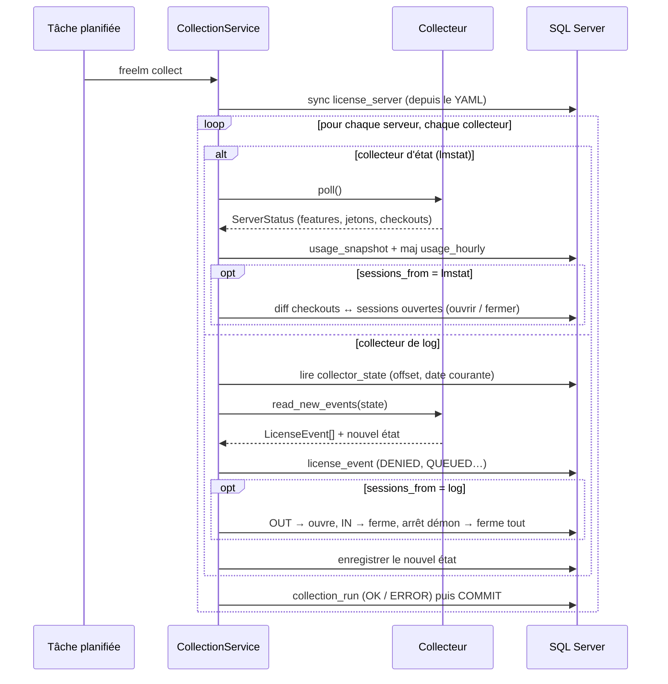
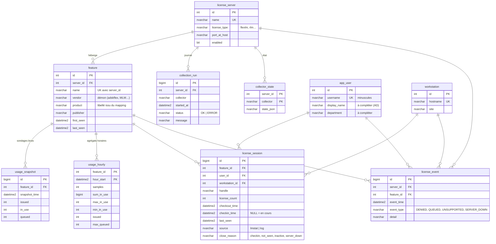

# Architecture de FreeLM

## 1. Vue d'ensemble

FreeLM est un outil **en ligne de commande**, sans interface graphique ni agent
sur les postes clients. Il tourne sur un serveur Windows (ou n'importe quelle
machine avec Python 3.10+) via le Planificateur de tâches :



## 2. Modules

```
freelm/
├── cli.py                  Point d'entrée (init-db, collect, report, import-log, purge…)
├── config.py               Chargement/validation du YAML, mapping feature → produit
├── models.py               Modèle normalisé : ServerStatus, FeatureStatus, Checkout, LicenseEvent
├── service.py              Orchestration : exécute les collecteurs, reconstruit les sessions, écrit en base
├── collectors/
│   ├── base.py             Interfaces StatusCollector / LogCollector + registre
│   └── flexlm/
│       ├── lmstat.py       Exécution de lmutil lmstat + parser de la sortie
│       └── logfile.py      Parser du log debug + lecture incrémentale (offset, rotation)
├── storage/
│   ├── db.py               Connexion DB-API (pyodbc / sqlite3) et différences de dialecte
│   ├── schema.py           Schéma unique → DDL SQL Server et SQLite, vues de reporting
│   └── repository.py       Toutes les requêtes d'écriture
└── reporting/
    ├── dataset.py          Calcul des indicateurs (pur Python, testable)
    └── excel.py            Mise en forme du classeur (openpyxl)
```

Principes :

* **Séparation parsing / persistance** : les collecteurs ne connaissent pas la
  base ; ils renvoient des objets de `models.py`. On peut tester un parser sur
  une sortie texte sans aucune base (`freelm parse-lmstat fichier.txt`).
* **Registre de collecteurs** : `@register("flexlm", "lmstat")`. Ajouter RLM
  revient à écrire `collectors/rlm/rlmstat.py` qui produit les mêmes objets
  (voir §6) ; le service, la base et les rapports ne changent pas.
* **SQL portable** : requêtes paramétrées `?` compatibles pyodbc et sqlite3.
  SQL Server en production, SQLite pour les tests et les essais.
  Pas d'ORM : moins de dépendances, SQL lisible par un DBA.
* **Une transaction par serveur et par collecteur** : un serveur injoignable
  n'empêche pas la collecte des autres ; l'échec est tracé dans `collection_run`.

## 3. Flux de collecte



### Deux sources, un choix par serveur

| | `lmstat` (polling) | `log` (debug log) |
|---|---|---|
| Accès requis | réseau vers le port lmgrd + `lmutil` | lecture du fichier log (partage SMB) |
| Jetons émis / en cours | ✅ | ❌ |
| Sessions | ✅ précision = intervalle de sondage | ✅ à la seconde |
| Refus (DENIED) / files d'attente | ❌ (seulement la file courante) | ✅ |
| Reprise d'historique | ❌ | ✅ (`freelm import-log`) |

Recommandation : `lmstat` partout ; ajouter `log` là où le fichier est
accessible, en prenant alors `sessions_from: log`. Les deux collecteurs
alimentent la même base, mais **une seule source de sessions par serveur**
pour éviter les doublons.

### Reconstruction des sessions depuis lmstat

À chaque sondage, chaque checkout est identifié par
`(feature, utilisateur, poste, handle)` (le *handle* FlexLM est unique par
checkout) :

* présent maintenant, absent en base → nouvelle session (début = heure de
  début donnée par lmstat) ;
* présent en base, absent maintenant → session fermée ; fin estimée au milieu
  de l'intervalle entre les deux sondages (plafonné à 30 min si la collecte a
  été interrompue) ;
* démon vendeur en panne → les sessions de ce démon restent ouvertes (on ne
  sait pas si les jetons ont été rendus) ;
* serveur injoignable → aucune modification.

### Log debug : date et incrémental

Les lignes du log FlexLM ne portent que l'heure. La date vient des lignes
`TIMESTAMP M/D/YYYY` et `started on … (M/D/YYYY)` ; un recul de l'heure de plus
de 2 h est interprété comme un passage de minuit. L'état persistant
(`collector_state`) contient l'offset lu, la signature des 256 premiers octets
(détection de rotation / recréation du fichier) et la date courante. Une ligne
incomplète (en cours d'écriture) n'est jamais consommée.

## 4. Schéma de base de données

Script complet : [`sql/sqlserver/01_schema.sql`](../sql/sqlserver/01_schema.sql)
(généré par `freelm ddl --dialect mssql`).



Choix de conception :

* **`usage_hourly`** est mis à jour à chaque sondage (samples, somme, min, max).
  Les rapports ne lisent que cette table pour les taux d'utilisation : un an
  de rapport = quelques centaines de milliers de lignes au lieu de dizaines de
  millions de sondages. Les sondages bruts (`usage_snapshot`) sont purgés après
  `retention.snapshots_days` jours.
* **OUT/IN ne sont pas stockés comme évènements** : ils sont matérialisés en
  `license_session`. `license_event` ne garde que ce qui n'est pas une session
  (refus, files d'attente, arrêts).
* **Dimensions `app_user` / `workstation`** : les colonnes `display_name`,
  `department`, `site` sont vides à la collecte ; elles peuvent être alimentées
  par un script (export AD, CSV RH) et apparaissent alors dans les rapports.
* **Dates en heure locale** (`DATETIME2(0)`), celle du serveur FreeLM et des
  logs. Tous les serveurs de licences sont supposés dans le même fuseau.
* **Vues** `v_session_detail`, `v_usage_hourly`, `v_denial` : données
  dénormalisées pour des requêtes ad hoc, Power Query ou un tableau croisé
  connecté directement à SQL Server depuis Excel.

## 5. Rapport Excel

`freelm report` produit un classeur avec les feuilles :

| Feuille | Contenu |
|---|---|
| Synthèse | Par produit : jetons émis, pic, moyenne, taux moyen / au pic / heures ouvrées, heures saturées, refus, utilisateurs, heures ; graphique des taux |
| Usage quotidien | Croisement date × produit (pic de jetons) + courbes du top N |
| Utilisateurs | Croisement utilisateur × produit (heures) + graphique top N |
| Profil horaire | Carte de chaleur heure × jour de semaine (taux moyen) |
| Contention | Jours avec saturation et/ou refus, par produit |
| Refus | Détail des DENIED |
| Sessions | Données brutes en Tableau Excel (base de vos propres TCD) |
| À propos | Période, filtres, définitions |

openpyxl ne crée pas de vrais tableaux croisés dynamiques : les croisements
usuels sont précalculés, et les données brutes sont livrées sous forme de
Tableaux Excel (Insertion › Tableau croisé dynamique en un clic).

## 6. Ajouter un autre gestionnaire de licences (ex. RLM)

1. Créer `freelm/collectors/rlm/rlmstat.py` :

   ```python
   from freelm.collectors.base import StatusCollector, register
   from freelm.models import ServerStatus

   @register("rlm", "rlmstat")
   class RlmstatCollector(StatusCollector):
       def poll(self) -> ServerStatus:
           output = ...  # rlmutil rlmstat -a -c port@host
           return parse_rlmstat(output)  # produit FeatureStatus / Checkout
   ```

2. L'importer dans `freelm/collectors/__init__.py`.
3. Déclarer le serveur :

   ```yaml
   - name: RLM_SRV
     license_type: rlm
     port_at_host: "5053@rlmsrv"
     collectors: [rlmstat]
     sessions_from: rlmstat
   ```

Pour un log, hériter de `LogCollector` et implémenter
`read_new_events(state) -> (events, new_state)`.
