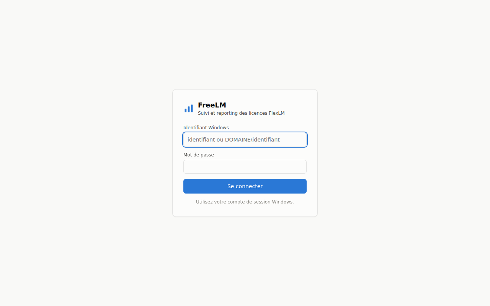

# Interface web partagée : connexion Windows / AD et HTTPS

Par défaut, l'interface (`freelm web`, `FreeLM.exe`) n'est accessible que depuis le
poste où elle tourne, sans authentification. Pour la partager sur le réseau, il faut
authentifier les utilisateurs avec leur compte Windows, et chiffrer les échanges.

| Mode (`web.auth.mode`) | Expérience utilisateur | Mise en œuvre |
|---|---|---|
| `none` | Aucune connexion | Poste local uniquement (défaut) |
| **`ldap`** (recommandé) | Page de connexion : identifiant et mot de passe Windows | FreeLM seul + certificat HTTPS |
| `header` | **Aucune saisie** (SSO, session Windows) | IIS en frontal avec l'authentification Windows |



## 1. Mode `ldap` : identifiants Windows vérifiés par l'Active Directory

### Prérequis

- **LDAPS** actif sur les contrôleurs de domaine (port 636 ; certificat délivré par
  l'AC d'entreprise — c'est le cas dès qu'une AD CS est déployée). À défaut :
  `ldap://` + `ldap_starttls: true` (port 389).
- Flux ouvert du serveur FreeLM vers les contrôleurs de domaine (636 ou 389).
- (recommandé) un groupe AD des personnes autorisées, ex. `GG_FreeLM_Lecteurs`.
- Un certificat HTTPS pour le serveur FreeLM (§ 3) : **obligatoire** dès que
  l'interface écoute sur le réseau, sans quoi FreeLM refuse de démarrer (les mots de
  passe circuleraient en clair).

### Configuration

```yaml
web:
  host: 0.0.0.0
  port: 8765
  tls_cert: "C:/FreeLM/certs/freelm.pem"
  tls_key:  "C:/FreeLM/certs/freelm.key"
  public_url: "https://freelm.entreprise.local:8765"
  auth:
    mode: ldap
    ldap_servers: ["ldaps://dc01.entreprise.local", "ldaps://dc02.entreprise.local"]
    base_dn: "DC=entreprise,DC=local"
    upn_suffix: "entreprise.local"          # connexion en identifiant@entreprise.local
    allowed_groups: ["GG_FreeLM_Lecteurs"]  # groupes imbriqués acceptés ; vide = tout le domaine
    session_hours: 8
```

Variante sans `upn_suffix` (annuaire non AD, ou comptes hors du suffixe) : un compte de
service en lecture recherche l'utilisateur, puis FreeLM vérifie son mot de passe.

```yaml
    bind_dn: "CN=svc_freelm_ldap,OU=Services,DC=entreprise,DC=local"
    bind_password: ${FREELM_LDAP_PASSWORD}
    user_filter: "(sAMAccountName={username})"
```

L'utilisateur peut saisir `jdupont`, `ENTREPRISE\jdupont` ou `jdupont@entreprise.local`.

### Comportement et sécurité

- Mot de passe transmis uniquement au contrôleur de domaine (bind LDAP chiffré), jamais
  stocké ni journalisé ; mot de passe vide refusé (pas de bind anonyme).
- Session : cookie aléatoire `HttpOnly`, `SameSite=Strict`, `Secure`, valable
  `session_hours` ; bouton « Se déconnecter ». Un redémarrage du service déconnecte tout le monde.
- Après `max_failures` échecs (5 par défaut) pour un même identifiant ou une même
  adresse IP : blocage de `lockout_minutes` (15 min). À régler en dessous du seuil de
  verrouillage des comptes AD.
- **Journal d'audit** (`freelm.log`, logger `freelm.audit`) : connexions, échecs,
  blocages, déconnexions et **chaque export** (utilisateur, rapport, format, filtres).

### Dépannage

| Symptôme | Cause probable | Solution |
|---|---|---|
| « Annuaire indisponible » + `certificate verify failed` dans le journal | AC interne inconnue de Python | Exporter le certificat racine de l'AC (Base-64) et le déclarer : `ldap_ca_file` |
| « Annuaire indisponible » + délai dépassé | Flux 636 fermé | Ouvrir le pare-feu vers les DC, ou `ldap://` + `ldap_starttls` |
| « Identifiant ou mot de passe incorrect » alors qu'il est bon | Mauvais `upn_suffix` (UPN différent du domaine) | Utiliser la variante `bind_dn` |
| « Accès refusé : … aucun groupe autorisé » | Utilisateur hors de `allowed_groups` | Ajouter au groupe (reconnexion après réplication AD) |

## 2. Mode `header` : authentification unique avec IIS

IIS authentifie l'utilisateur de manière transparente (Kerberos/NTLM) et transmet son
nom à FreeLM, qui n'écoute que sur la boucle locale.

1. Installer IIS avec **Authentification Windows**, puis les modules
   [URL Rewrite](https://www.iis.net/downloads/microsoft/url-rewrite) et
   [Application Request Routing](https://www.iis.net/downloads/microsoft/application-request-routing)
   (ARR › *Server Proxy Settings* › *Enable proxy*).
2. Créer un site HTTPS (certificat du § 3, lié dans IIS) ; *Authentification* :
   **Windows activé, Anonyme désactivé**.
3. *URL Rewrite* › *View Server Variables* › ajouter `HTTP_X_REMOTE_USER`.
4. `web.config` du site :

   ```xml
   <configuration>
     <system.webServer>
       <rewrite>
         <rules>
           <rule name="FreeLM" stopProcessing="true">
             <match url="(.*)" />
             <serverVariables>
               <!-- écrase toute valeur envoyée par le navigateur -->
               <set name="HTTP_X_REMOTE_USER" value="{LOGON_USER}" />
             </serverVariables>
             <action type="Rewrite" url="http://127.0.0.1:8765/{R:1}" />
           </rule>
         </rules>
       </rewrite>
     </system.webServer>
   </configuration>
   ```

5. FreeLM :

   ```yaml
   web:
     host: 127.0.0.1            # jamais exposé directement
     port: 8765
     public_url: "https://freelm.entreprise.local"
     auth:
       mode: header
       header_name: X-Remote-User
       trusted_proxies: ["127.0.0.1", "::1"]
       allowed_users: []        # vide = tout utilisateur authentifié par IIS
   ```

   Restreindre l'accès à un groupe : *Règles d'autorisation* IIS (autoriser le groupe
   `GG_FreeLM_Lecteurs`, refuser les autres) ou liste `allowed_users`.

## 3. Certificat HTTPS

Demander un certificat serveur à l'AC d'entreprise pour le nom utilisé par les
navigateurs (ex. `freelm.entreprise.local`), l'exporter en `.pfx` avec la clé privée,
puis le convertir en PEM :

```powershell
openssl pkcs12 -in freelm.pfx -clcerts -nokeys -out freelm.pem
openssl pkcs12 -in freelm.pfx -nocerts -nodes -out freelm.key
```

(`openssl` est fourni avec Git pour Windows : `C:\Program Files\Git\usr\bin\openssl.exe`.)
Restreindre les droits NTFS du fichier `.key` au compte de service FreeLM et aux
administrateurs. Pour un simple essai : certificat auto-signé
`openssl req -x509 -newkey rsa:2048 -nodes -days 365 -subj "/CN=freelm.entreprise.local" -keyout freelm.key -out freelm.pem`
(le navigateur affichera un avertissement).

## 4. Interface permanente

```powershell
scripts\register_tasks.ps1 -FreeLMHome C:\FreeLM -ServiceAccount "DOMAINE\svc_freelm" -WithWebInterface
```

Ajoute la tâche « FreeLM - Interface web », démarrée avec le serveur et relancée
automatiquement en cas d'arrêt ; adresse, HTTPS et authentification sont lus dans la
section `web` du YAML. Ouvrir le port choisi dans le pare-feu Windows du serveur.
