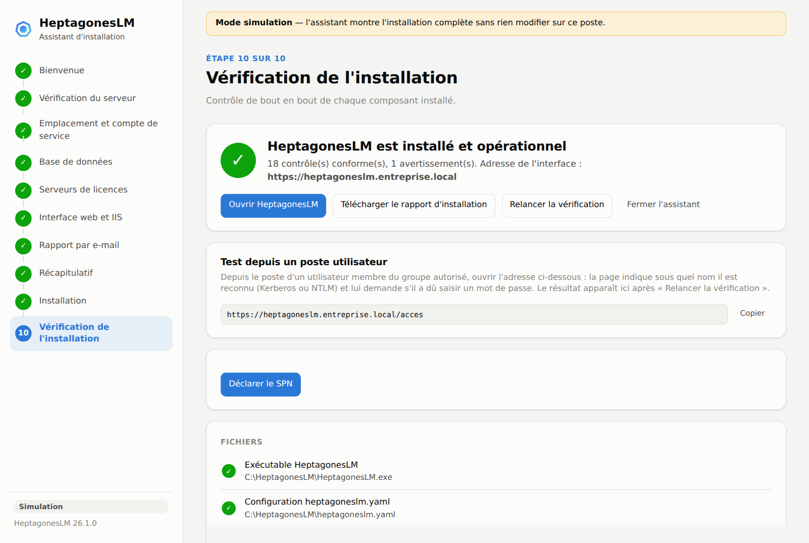
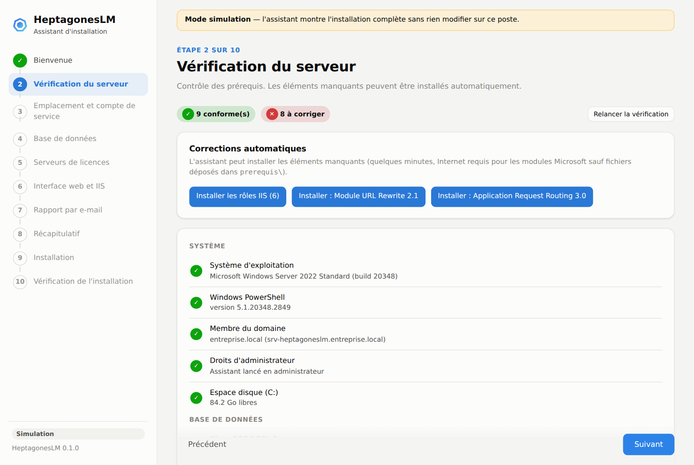
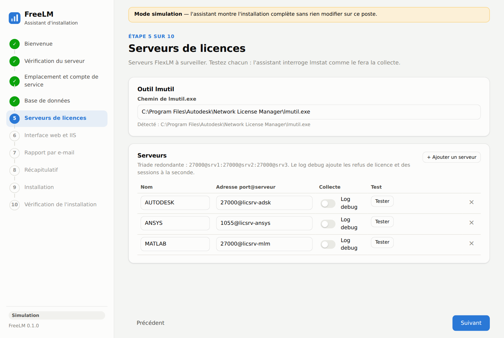
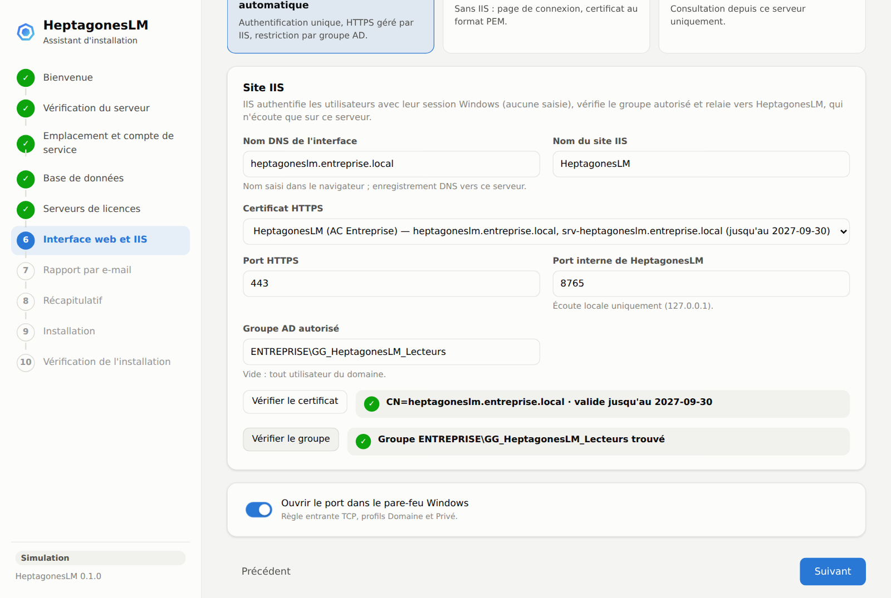
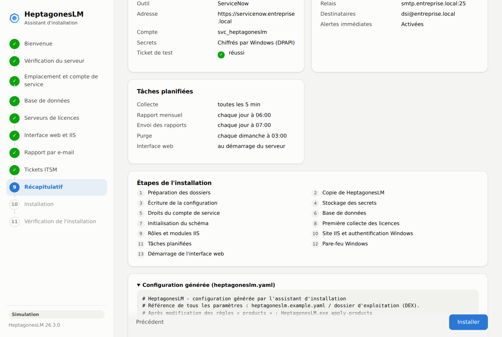
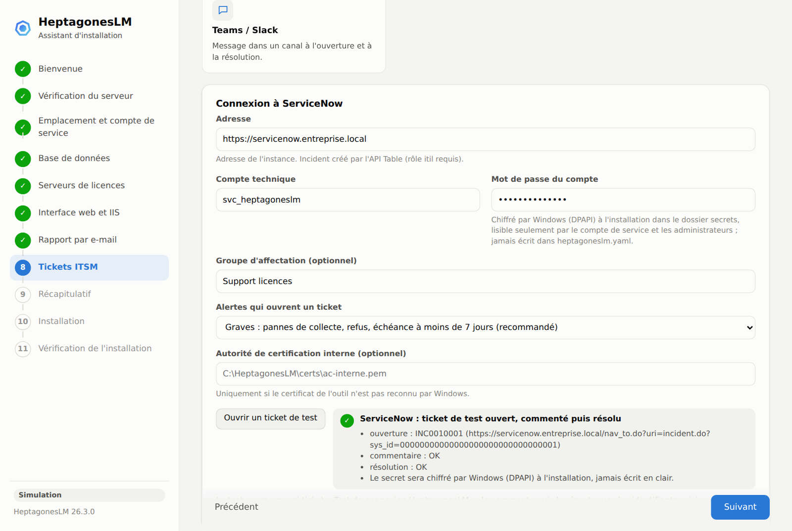
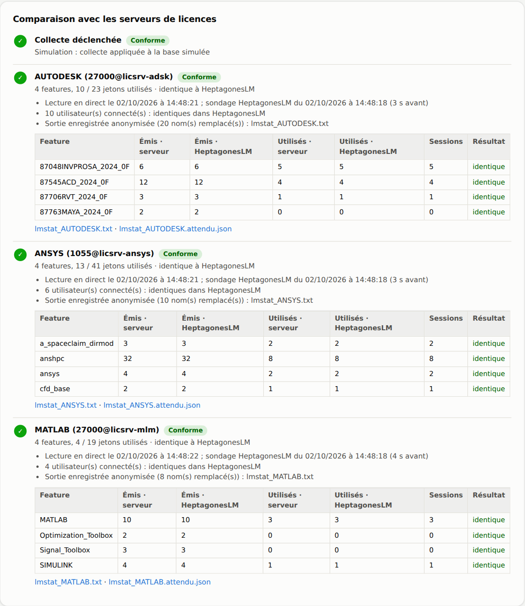
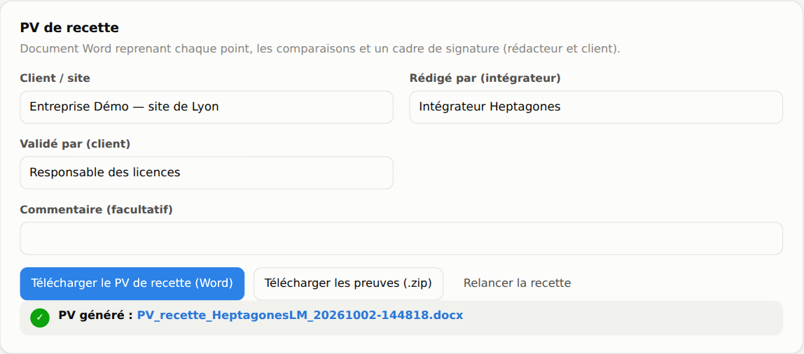
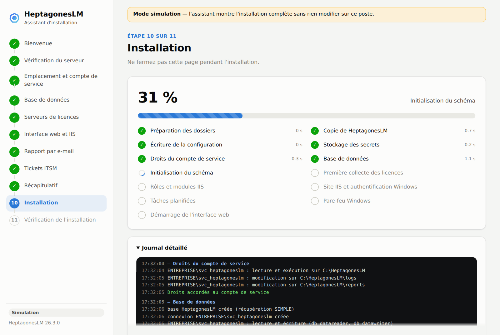
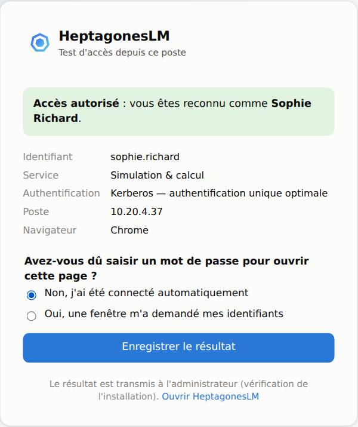

# Installation assistée : HeptagonesLM-Setup.exe

`HeptagonesLM-Setup.exe` installe HeptagonesLM sur un serveur Windows en une vingtaine de minutes,
sans éditer de fichier : un assistant pas à pas s'ouvre dans le navigateur, contrôle
les prérequis, configure la base, les serveurs de licences, IIS et les tâches planifiées,
installe avec une barre de progression, puis **vérifie chaque composant de bout en bout**.



## Sommaire

1. [Avant de commencer](#1-avant-de-commencer)
2. [Lancer l'assistant](#2-lancer-lassistant)
3. [Les étapes](#3-les-étapes)
4. [Ce que fait l'installation](#4-ce-que-fait-linstallation)
5. [Installation silencieuse](#5-installation-silencieuse-industrialisation)
6. [Mettre à jour une installation existante](#6-mettre-à-jour-une-installation-existante)
7. [Serveur sans accès Internet](#7-serveur-sans-accès-internet)
8. [Sécurité de l'assistant](#8-sécurité-de-lassistant)
9. [Authentification unique : SPN, zone Intranet et test depuis un poste](#9-authentification-unique--spn-zone-intranet-et-test-depuis-un-poste)
10. [Dépannage](#10-dépannage)

## 1. Avant de commencer

| À préparer | Détail |
|---|---|
| Serveur | Windows Server 2016 ou plus récent, membre du domaine, compte administrateur local |
| Compte de service | Compte dédié non administrateur, de préférence un **gMSA** (`DOMAINE\gmsa_heptagoneslm$`) ; sinon compte + mot de passe |
| SQL Server | Nom de l'instance ; votre compte doit pouvoir créer la base (sysadmin ou dbcreator), sinon le DBA exécute `sql\sqlserver\00_create_database.sql` |
| Certificat HTTPS | Importé dans *Ordinateur local › Personnel* (avec clé privée) pour le nom DNS de l'interface |
| Nom DNS | Enregistrement A ou CNAME (ex. `heptagoneslm.entreprise.local`) vers le serveur |
| Serveurs de licences | Adresses `port@serveur`, flux réseau ouverts (port lmgrd et ports des démons) |
| Groupe AD | Personnes autorisées à consulter HeptagonesLM (ex. `GG_HeptagonesLM_Lecteurs`) |
| lmutil.exe | Fourni avec Autodesk Network License Manager ou tout serveur FlexLM |
| rlmutil.exe | Serveurs RLM (Reprise : Foundry, Maxon, Chaos…) uniquement ; fourni avec le serveur de licences de l'éditeur |
| Pilote ODBC | *ODBC Driver 18 for SQL Server* (contrôlé par l'assistant, lien de téléchargement fourni) |

## 2. Lancer l'assistant

1. Copier `HeptagonesLM-Setup.exe` sur le serveur (page Releases) et vérifier son empreinte :
   `Get-FileHash HeptagonesLM-Setup.exe -Algorithm SHA256` (comparer à `SHA256SUMS`).
2. Double-cliquer : Windows demande l'élévation (droits administrateur requis).
3. Une fenêtre console affiche l'adresse de l'assistant et le navigateur s'ouvre.
   **Laisser la console ouverte** pendant toute l'installation.

Démonstration sans rien modifier : `HeptagonesLM-Setup.exe setup --simulate` (tout poste, même non Windows
avec Python : `heptagoneslm setup --simulate`).

## 3. Les étapes

| # | Étape | Contenu | Tests proposés |
|---|---|---|---|
| 1 | Bienvenue | Résumé, informations sur le serveur, éléments à préparer | — |
| 2 | Vérification du serveur | Système, droits, disque, domaine, pilote ODBC, lmutil, port, rôles et modules IIS, certificats | Corrections automatiques : rôles IIS, URL Rewrite, ARR |
| 3 | Emplacement et compte | Dossier d'installation, compte de service, intervalle de collecte | Compte trouvé dans l'annuaire, mot de passe valide |
| 4 | Base de données | SQL Server (instance, base, pilote, authentification Windows ou SQL, chiffrement, création) ou SQLite | Connexion, existence de la base, droits de création |
| 5 | Serveurs de licences | Serveurs : type, adresse (triades), log debug ; chemin (ou dossier) de lmutil (FlexLM) et de rlmutil (RLM), ou bouton « Rechercher l'outil » (ce serveur et les serveurs de licences ; copie dans `bin` si trouvé ailleurs) | `lmstat` / `rlmstat` en direct pour chaque serveur |
| 6 | Interface web et IIS | IIS avec connexion Windows automatique (recommandé), HTTPS intégré avec identifiants AD, ou poste local ; pare-feu | Certificat (nom, validité), groupe AD, connexion LDAP |
| 7 | Rapport par e-mail | Relais SMTP, expéditeur, destinataires, alertes immédiates (optionnel) | Envoi d'un message de test |
| 8 | Tickets ITSM | Activation (désactivé par défaut) ; ServiceNow, Jira, GLPI ou Teams / Slack : adresse, compte technique et mot de passe ou jetons, projet ou groupe d'affectation, gravité minimale, AC interne facultative | « Ouvrir un ticket de test » : vrai ticket ouvert, commenté puis résolu |
| 9 | Licences Autodesk nommées | Optionnel : dossier surveillé des exports du portail Autodesk Account, seuil d'inactivité ; API Autodesk Business Success Plan (Client ID, Client Secret facultatif chiffré par DPAPI) — [guide](AUTODESK_API.md) | « Se connecter à Autodesk » : connexion d'un administrateur, choix de l'équipe |
| 10 | Récapitulatif | Configuration, contrôle final des prérequis, tâches, étapes, `heptagoneslm.yaml` généré | — |
| 11 | Installation | Barre de progression, étapes en direct, journal détaillé ; « Réessayer » reprend à l'étape en échec | — |
| 12 | Vérification | Contrôle de bout en bout (dont le secret ITSM déchiffrable), adresse de l'interface, rapport d'installation téléchargeable | — |
| 13 | Recette | Sur l'installation en place (aussi depuis l'accueil quand HeptagonesLM est déjà installé) : collecte planifiée déclenchée, `lmstat` / `rlmstat` en direct comparé à la base feature par feature, collecte planifiée sur N heures, vérification, connexion depuis les postes, refus hors du groupe, e-mail, ticket ITSM et rapport Excel de test confirmés par l'opérateur | PV de recette Word à signer, archive des preuves (sorties anonymisables, résumés attendus) |

<table>
<tr>
<td></td>
<td></td>
</tr>
<tr>
<td align="center"><em>Prérequis et corrections automatiques</em></td>
<td align="center"><em>Serveurs de licences testés en direct</em></td>
</tr>
<tr>
<td></td>
<td></td>
</tr>
<tr>
<td align="center"><em>IIS : certificat, groupe autorisé</em></td>
<td align="center"><em>Récapitulatif avant installation</em></td>
</tr>
<tr>
<td></td>
<td></td>
</tr>
<tr>
<td align="center"><em>Tickets ITSM : ticket de test ServiceNow</em></td>
<td align="center"><em>Vérification finale de bout en bout</em></td>
</tr>
<tr>
<td></td>
<td></td>
</tr>
<tr>
<td align="center"><em>Recette : comparaison feature par feature avec lmstat</em></td>
<td align="center"><em>Recette : PV de recette Word et preuves</em></td>
</tr>
</table>



## 4. Ce que fait l'installation

Chaque étape est **idempotente** : relancer l'assistant (ou « Réessayer ») ne casse rien.

| Étape | Action |
|---|---|
| Dossiers | `C:\HeptagonesLM` avec `logs`, `reports` (et `data` en SQLite, `iis` en mode IIS) |
| Copie de HeptagonesLM | `HeptagonesLM.exe` embarqué dans l'assistant copié dans le dossier |
| Configuration | `heptagoneslm.yaml` généré et validé ; l'ancienne version est sauvegardée (`.bak`) |
| Secrets | Mots de passe SQL / SMTP dans des variables d'environnement machine (`HEPTAGONESLM_DB_PASSWORD`, `HEPTAGONESLM_SMTP_PASSWORD`) ; mot de passe ou jetons de l'outil ITSM chiffrés par Windows (DPAPI) dans `secrets\` (dossier réservé à SYSTEM, aux administrateurs et au compte de service), référencés par `dpapi:` ; jamais dans le fichier |
| Droits | Compte de service : lecture sur le dossier, modification sur `logs`, `reports`, `data` |
| Base | Création de la base (récupération SIMPLE), de la connexion Windows du compte de service, rôles `db_datareader` / `db_datawriter` |
| Schéma | `HeptagonesLM.exe init-db` |
| Première collecte | `HeptagonesLM.exe collect` : chaque serveur de licences est interrogé |
| IIS | Rôles et modules manquants, pool .NET v4.0 (pipeline intégré), site HTTPS (liaison SNI + certificat), authentification Windows seule, proxy ARR, module `HeptagonesLMUserHeader` (en-tête `X-Remote-User` posé après l'authentification), autorisation du groupe, `web.config` de relais vers HeptagonesLM (écoute locale) |
| Tâches | Collecte, rapport mensuel, envoi des e-mails, purge, interface web permanente (lancée au démarrage du serveur), sous le compte de service ; **surveillance de l'interface** toutes les 5 minutes sous SYSTEM : relance l'interface si elle ne tourne pas (démarrage raté parce que le domaine ou la base n'étaient pas encore prêts, par exemple). Toutes les tâches tournent aussi sur batterie |
| Pare-feu | Règle entrante sur le port HTTPS (profils Domaine et Privé) |
| Démarrage | Lancement de l'interface et attente de sa réponse |
| Raccourci | Icône **HeptagonesLM** sur le bureau de tous les utilisateurs et dans le menu Démarrer : ouvre le tableau de bord (adresse publique) |

La vérification finale contrôle : exécutable et configuration, schéma de la base, dernière
collecte de chaque serveur, présence et état des tâches, réponse de HeptagonesLM, site IIS démarré
et chaîne HTTPS + authentification Windows (401 attendu sans identifiants), règle de pare-feu,
résolution DNS. Le rapport d'installation est aussi écrit dans `C:\HeptagonesLM\logs\setup-*.log`.

## 5. Installation silencieuse (industrialisation)

```powershell
$env:SVC_PWD = Read-Host "Mot de passe du compte de service"
HeptagonesLM-Setup.exe setup --answers reponses.json
```

Mêmes contrôles, étapes et vérification que l'assistant, avec une progression en mode texte.
Les valeurs `${VARIABLE}` sont remplacées par les variables d'environnement (mots de passe
hors du fichier). Codes retour : **0** succès, **1** échec, **2** installé avec des erreurs de vérification.

```json
{
  "install_dir": "C:\\HeptagonesLM",
  "service_account": "ENTREPRISE\\gmsa_heptagoneslm$",
  "db_server": "SQLSRV01",
  "db_name": "HeptagonesLM",
  "lmutil_path": "C:\\HeptagonesLM\\bin\\lmutil.exe",
  "servers": [
    { "name": "AUTODESK", "port_at_host": "27000@licsrv1" },
    { "name": "ANSYS", "port_at_host": "1055@licsrv2", "collectors": ["lmstat", "log"],
      "log_path": "\\\\licsrv2\\ansys_logs$\\license.log" }
  ],
  "web_mode": "iis",
  "public_host": "heptagoneslm.entreprise.local",
  "iis_cert_thumbprint": "3F2A9C4D8E1B7A6F5C0D2E9B8A7F6C5D4E3B2A19",
  "access_group": "ENTREPRISE\\GG_HeptagonesLM_Lecteurs",
  "auto_fix": true
}
```

| Clé | Défaut | Rôle |
|---|---|---|
| `install_dir` | `C:\HeptagonesLM` | Dossier d'installation |
| `service_account` / `service_password` | — | Compte des tâches (mot de passe inutile pour un gMSA) |
| `collect_interval` | 5 | Minutes entre deux collectes |
| `db_mode` | `sqlserver` | `sqlserver` ou `sqlite` |
| `db_server`, `db_name`, `db_driver` | —, `HeptagonesLM`, ODBC 18 | Connexion SQL Server |
| `db_auth`, `db_user`, `db_password` | `windows` | `windows` (compte de service) ou `sql` |
| `db_encrypt`, `db_trust_cert`, `db_create` | `true`, `false`, `true` | Chiffrement, confiance du certificat SQL, création de la base |
| `lmutil_path`, `servers[]` | — | `name`, `port_at_host`, `collectors`, `log_path` |
| `web_mode` | `iis` | `iis`, `https` ou `local` |
| `web_port` | 8765 | Port interne (IIS) ou HTTPS (mode `https`) |
| `public_host`, `access_group` | — | Nom DNS, groupe `DOMAINE\groupe` autorisé |
| `iis_site`, `iis_port`, `iis_cert_thumbprint` | `HeptagonesLM`, 443 | Site IIS et certificat (empreinte) |
| `tls_cert`, `tls_key`, `ldap_servers`, `base_dn`, `upn_suffix` | — | Mode `https` |
| `open_firewall` | `true` | Règle de pare-feu |
| `email_enabled`, `smtp_host`, `smtp_port`, `smtp_security`, `smtp_user`, `smtp_password`, `sender`, `recipients` | désactivé | Rapport par e-mail |
| `itsm_enabled`, `itsm_type`, `itsm_url`, `itsm_user`, `itsm_password`, `itsm_app_token`, `itsm_project`, `itsm_issue_type`, `itsm_assignment_group`, `itsm_format`, `itsm_min_severity`, `itsm_ca_file` | désactivé, `servicenow`, …, `serious` | Tickets ITSM (`itsm_password` : mot de passe ServiceNow, jeton Jira ou jeton utilisateur GLPI ; `${VARIABLE}` conseillé) |
| `auto_fix` | `false` | Installer automatiquement les rôles et modules IIS manquants |

## 6. Mettre à jour une installation existante

Télécharger le nouveau `HeptagonesLM-Setup.exe` et le lancer sur le serveur. Sur la page d'accueil,
l'assistant reconnaît l'installation et sa version. Le bouton **« Mettre à jour vers 26.3.x »** :

1. **sauvegarde** `heptagoneslm.yaml`, les réponses de l'assistant, `web.config` et la base SQLite dans
   `<installation>\backup\<horodatage>\` (base SQL Server : sauvegarde par le DBA, le schéma n'évolue que
   par ajouts) ;
2. remplace `HeptagonesLM.exe` (HeptagonesLM en cours d'exécution est arrêté puis relancé) ;
3. met à jour le schéma de la base (`init-db`) ;
4. ajoute la surveillance de l'interface (relance automatique, sous SYSTEM), redémarre l'interface web et
   lance une collecte de contrôle ;
5. crée l'icône **HeptagonesLM** sur le bureau ;
6. enchaîne sur la vérification de bout en bout, puis propose la recette.

**Rien n'est ressaisi** : configuration, réglages personnalisés, mots de passe (variables d'environnement
machine, secrets DPAPI), tâches planifiées, site IIS et droits restent tels quels. La version installée est
notée dans `setup-reponses.json`.

En mode silencieux (déploiement par script) :

```
HeptagonesLM-Setup.exe setup --update [--install-dir D:\HeptagonesLM]
```

Codes retour : 0 mise à jour vérifiée, 1 échec (la sauvegarde permet le retour arrière), 2 mise à jour
faite avec des erreurs de vérification.

**Réinstallation complète** (bouton « Réinstaller ») : l'assistant réécrit `heptagoneslm.yaml` à partir des
réponses, mais **conserve les réglages ajoutés à la main** (`products`, `sites`, `retention`, réglages de
`reporting`, coûts Autodesk, rôles, abonnements e-mail supplémentaires, types d'alertes) ; l'ancien fichier
est gardé en `heptagoneslm.yaml.<horodatage>.bak`.

### Ajouter les licences Autodesk à une installation existante

Sur la page d'accueil, **« Configurer les licences Autodesk »** ouvre l'étape Autodesk (exports du portail,
API Autodesk). Seule la section `autodesk` de `heptagoneslm.yaml` est écrite. Le reste de l'installation
est conservé et rien n'est ressaisi. Voir [AUTODESK_API.md](AUTODESK_API.md) § 2.

### Fermer l'assistant

Au double-clic, la fenêtre console du Setup est masquée : seul le navigateur s'affiche. En fin
d'installation, de mise à jour ou de recette, cliquer sur **« Quitter l'assistant »**. Sans onglet ouvert
pendant 30 minutes, l'assistant s'arrête aussi tout seul, sauf si une opération est en cours.

### Signature de l'exécutable

`HeptagonesLM-Setup.exe` et `HeptagonesLM.exe` sont signés (Authenticode, horodatage RFC 3161) quand le
certificat de signature de code de l'éditeur est configuré dans GitHub (secrets `SIGN_PFX_BASE64` : fichier
`.pfx` encodé en base64, et `SIGN_PFX_PASSWORD`). Vérification sur le serveur :
`Get-AuthenticodeSignature .\HeptagonesLM-Setup.exe` → `Valid`. Un certificat **EV** supprime immédiatement
l'alerte SmartScreen ; un certificat **OV** après quelques centaines de téléchargements. Sans certificat, la
CI valide la procédure avec un certificat de test (exécutables non distribués).

## 7. Serveur sans accès Internet

Les rôles IIS s'installent depuis Windows. Les modules **URL Rewrite** et **ARR** sont
téléchargés chez Microsoft ; hors ligne, déposer les installeurs à côté de
`HeptagonesLM-Setup.exe` ou dans un sous-dossier `prerequis\` :

- `rewrite_amd64_en-US.msi` (URL Rewrite 2.1)
- `requestRouter_amd64.msi` (Application Request Routing 3.0)

## 8. Sécurité de l'assistant

- Écoute sur `127.0.0.1` uniquement, jeton aléatoire propre à la session (retiré de
  l'adresse et conservé dans un cookie `HttpOnly`, `SameSite=Strict`), contrôle de l'en-tête
  `Host`, en-tête obligatoire sur les requêtes de modification (anti requêtes intersites).
- Mots de passe gardés en mémoire le temps de l'installation, transmis à PowerShell par une
  variable d'environnement du seul processus enfant (jamais en ligne de commande), absents du
  journal et du rapport d'installation.
- Compte SYSTEM refusé pour les tâches ; droits minimaux sur les dossiers et la base.
- Secrets de l'outil ITSM chiffrés par Windows (DPAPI, portée machine) : un fichier copié sur un
  autre serveur est indéchiffrable ; déchiffrés en mémoire au moment de l'appel seulement.
- HeptagonesLM n'écoute que sur la boucle locale derrière IIS ; les en-têtes `X-Remote-User` et
  `X-Remote-Auth-Method` ne sont acceptés que du proxy local et sont toujours supprimés puis
  posés par le module IIS (une valeur envoyée par le navigateur est ignorée).

## 9. Authentification unique : SPN, zone Intranet et test depuis un poste

Pour que les utilisateurs arrivent connectés **sans saisir de mot de passe**, trois conditions
côté infrastructure sont contrôlées par l'assistant (juste avant l'installation, puis à la
vérification finale). Ces contrôles ne bloquent jamais l'installation ; chacun donne la
commande à exécuter (bouton *Copier*).

| Contrôle | Ce qui est vérifié | Correction |
|---|---|---|
| **SPN Kerberos** | `HTTP/<nom public>` est déclaré sur le compte ordinateur du serveur (recherche dans l'annuaire). Nom du serveur lui-même : couvert d'office. | SPN absent : bouton **Déclarer le SPN** (droits d'administrateur du domaine) ou `setspn -S HTTP/heptagoneslm.entreprise.local NOMSERVEUR` par un administrateur. SPN porté par un autre compte (erreur : Kerberos échouerait) : commandes `setspn -D` / `setspn -S` fournies. Sans SPN, l'accès fonctionne en NTLM. |
| **Zone Intranet local** | Le site est attribué à la zone 1 par la GPO « Liste des attributions de sites aux zones », et les stratégies `AuthServerAllowlist` d'Edge / Chrome (si définies) incluent le nom. Un nom avec des points est en zone Internet par défaut : sans GPO, les navigateurs demandent les identifiants. | GPO *Configuration ordinateur › Modèles d'administration › Composants Windows › Internet Explorer › Panneau de configuration Internet › Page Sécurité › Liste des attributions de sites aux zones* : `https://heptagoneslm.entreprise.local` = `1`. Commande fournie pour tester sur un seul poste. Le contrôle lit les stratégies du serveur : il est indicatif, le test depuis un poste le confirme. |
| **Test depuis un poste utilisateur** | Un utilisateur ouvre `https://<nom public>/acces` depuis son poste : la page affiche le nom sous lequel il est reconnu, la méthode (Kerberos ou NTLM, transmise par le module IIS) et lui demande s'il a dû saisir un mot de passe. | Les résultats (poste, navigateur, méthode, saisie ou non) apparaissent dans la vérification finale après *Relancer la vérification*. « Mot de passe demandé » : zone Intranet à corriger sur ce poste ; « NTLM » : déclarer le SPN. |



Les résultats des tests sont conservés dans `C:\HeptagonesLM\logs\tests-acces.jsonl`
(200 derniers) et tracés dans le journal d'audit. La page `/acces` reste disponible après
l'installation pour diagnostiquer le poste d'un utilisateur.

## 10. Dépannage

| Symptôme | Solution |
|---|---|
| « Droits d'administrateur » en erreur | Relancer par clic droit › *Exécuter en tant qu'administrateur* |
| Module URL Rewrite / ARR : échec de téléchargement | Serveur hors ligne ou proxy : déposer les MSI (§ 6) puis « Relancer la vérification » |
| Rôles IIS installés mais « redémarrage nécessaire » | Redémarrer le serveur puis relancer l'assistant (les étapes déjà faites sont rejouées sans effet) |
| Base : « droits insuffisants pour la créer » | Utiliser un compte sysadmin / dbcreator, ou faire exécuter `00_create_database.sql` par le DBA et décocher la création |
| Serveur de licences injoignable au test | Vérifier `port@serveur`, le pare-feu (port lmgrd **et** port du démon éditeur) |
| Échec à l'étape « Tâches planifiées » | Mot de passe du compte de service ; pour un gMSA : `Install-ADServiceAccount` sur le serveur |
| Vérification : « IIS ne joint pas HeptagonesLM (502) » | La tâche « HeptagonesLM - Interface web » est arrêtée : consulter `C:\HeptagonesLM\logs\heptagoneslm.log` |
| Tableau de bord injoignable après un redémarrage du serveur | La surveillance relance l'interface dans les 5 minutes. Sinon : `Get-ScheduledTask -TaskPath '\HeptagonesLM\' \| Get-ScheduledTaskInfo \| Format-Table TaskName, LastRunTime, LastTaskResult` et `C:\HeptagonesLM\logs\heptagoneslm.log` (installation antérieure à 26.3.2 : lancer la mise à jour) |
| Navigateur : avertissement de certificat | Le certificat ne couvre pas le nom DNS choisi (test « Vérifier le certificat ») |
| Connexion Windows qui redemande un mot de passe | Faire ouvrir `https://heptagoneslm.entreprise.local/acces` depuis le poste concerné, puis suivre les contrôles *SPN Kerberos* et *Zone Intranet local* de la vérification finale (§ 8) |
